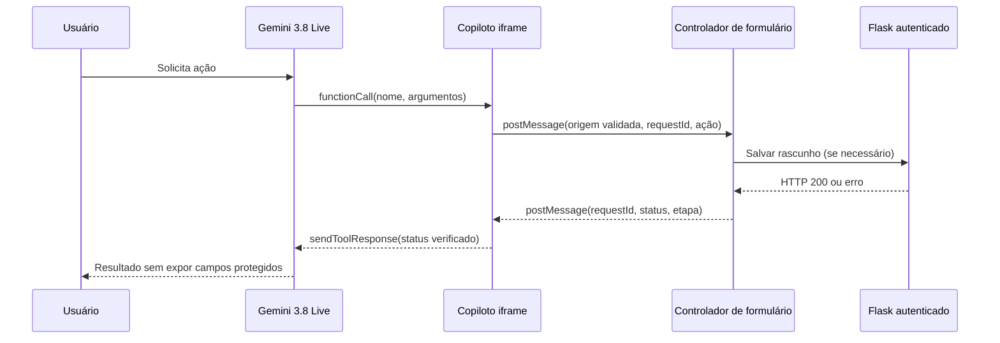

# Potiguar — Copiloto Operacional com ferramentas de aplicação

**Data:** 14/11/2026
**Estado:** MVP implementado na branch isolada `feat/potiguar-conversational-controller-20261113`; não equivale a controle irrestrito do sistema.
**Controle humano:** todas as operações ficam sujeitas a permissões RBAC, confirmação humana para alterações críticas e auditoria do backend.

## Problema confirmado

O Copiloto original tinha navegação limitada à correção de etapas e sugestões de campos do cadastro. Respostas de ferramenta como `requested` ou `pending_form_validation` podiam chegar antes de a interface validar e gravar. O painel principal apenas orientava ou oferecia links manuais. Não havia um catálogo formal de ações de navegação para outros módulos administrativos.

## MVP de execução implementado

### Navegação oficial (`navigate_potiguar`)

Destinos declarados:
- `dashboard` — painel de gestão (`admin.dashboard`).
- `attendance` — histórico de ponto (`admin.history`).
- `reports` — relatórios (`admin.reports`), exige `PUNCH_VIEW`.
- `employees` — listagem de funcionários (`admin.list_users`).
- `drafts` — rascunhos V2 (`admin.onboarding_drafts`), exige `USERS_CREATE`.
- `new_employee` — abre o fluxo V2 (`admin.new_user`), exige `USERS_CREATE`.

O Gemini escolhe apenas o nome do destino. O backend em `/admin/copilot/meta` publica as URLs internas autorizadas e o frontend rejeita links externos, consultas ou fragmentos. O roteamento devolve `navigation_started` (não declara página carregada) e a sessão Live atual se encerra ao trocar de tela.

### Manipulação controlada do formulário (`operate_onboarding`)

Ações disponíveis:
- `get_state`: retorna somente etapa e nome técnico do campo, **nunca valores**.
- `save_draft`: aguarda o resultado do POST autenticado e do controle de versão.
- `focus_current_field`: minimiza o painel e foca o campo corrente no formulário.
- `skip_optional`: avança na sessão somente quando o campo atual não for obrigatório.

Ferramentas anteriores mantidas:
- `navigate_onboarding`: abrir etapa já visitada / corrigir campo, condicionado à validação.
- `suggest_onboarding_fields`: sugerir somente o campo seguro ativo; o controlador valida, aplica e aguarda salvamento real.

### Contrato de recibos

O controlador valida origem/fonte de `postMessage`, requestId, etapa, permissões efetivas, campo ativo e regras determinísticas. Recibos trafegam somente status, etapa e, na leitura de estado, nome do campo. A IA não recebe valores já digitados. O modelo não executa API de escrita direta e não conclui funcionário, ativa usuário, manipula biometria ou registra ponto.

## Evidências de 14/11/2026

| Verificação | Resultado |
| --- | --- |
| Testes JS (navegação, ações, VAD, privacidade, ferramentas) | 31/31 aprovados |
| Testes Flask (RBAC/meta, segurança, onboarding) | 19/19 aprovados em Docker isolado |
| Chrome headless, viewport móvel 412 × 896 | 19/19 verificações, sem funcionários criados |
| Compilação Vite | Aprovada (aviso de bundle acima de 500 kB, sem erro) |
| Gemini 3.8 Live v1alpha real, token efêmero | Executou `navigate_potiguar(destination=dashboard)`, recibo de ferramenta enviado, sem erro de provedor |
| Microfone e voz | Validados em testes complementares anteriores, não reexecutados nesta missão |

Os 19 casos de interface validam o controlador real com Flask HTML, mas **simulam o endpoint de persistência**; os 19 testes Flask validam a API separadamente. Uma sessão ponta a ponta, envolvendo Gemini + DOM + API real e telefone físico, ainda precisa de aceite.

## Fronteiras atuais

1. A navegação entre telas é real, mas ocorre na mesma aba e **interrompe a sessão de voz**. Ainda não existe Copiloto persistente em todas as páginas.
2. Apenas o Gemini `gemini-3.8-live` possui ferramentas habilitadas no Copiloto atual; o modelo Extended continua orientativo. A orquestração híbrida poderá ser avaliada posteriormente.
3. Não existem ferramentas para pesquisar/alterar filtros no histórico ou relatórios, consultar agregados, ajustar registros, editar funcionários existentes ou operar qualquer outra rotina complexa. Cada operação necessita contrato, permissão, verificações e testes.
4. Termos de LGPD, consentimentos, segurança de dados pessoais e transferências externas exigem revisão independente antes de uso com dados reais.
5. Navegação para `new_employee` abre um rascunho. **Nunca equivale a criar um funcionário** e continua exigindo confirmação humana na revisão.

## Arquitetura futura: executor de ações do aplicativo

Construir um `AppActionBroker` (backend + frontend) com registro tipado por domínio, leitura de estado redigido, gateway RBAC, auditoria, idempotência e recibos por etapa:
- **Navegação e leitura:** consultar contexto ativo, buscar funcionários autorizados, abrir histórico, aplicar filtros e apresentar relatórios.
- **Rascunhos:** abrir, criar, atualizar, validar e salvar com revisão; separar campos protegidos em controles locais.
- **Operações sensíveis:** fluxo `prepare → review → human gate → execute → verify` para qualquer ação de escrita durável, exclusão, perfil de acesso, financeiro, ponto ou biometria.
- **Experiência persistente:** painel de Copiloto como componente compartilhado do layout e sessão gerenciada, com transferência de contexto entre rotas; preservação do isolamento de permissões.
- **Observabilidade:** trilha `request_id`, ferramenta, recurso, duração, decisão de política e resultado, sem incluir CPF/contas/senhas em logs.

**Não implementar automação genérica por clique arbitrário, execução de JavaScript gerado pelo LLM, SQL livre ou endpoints sem whitelist**. Isso contornaria RBAC e tornaria resultados difíceis de auditar.

## Critérios para promoção além do MVP

- Validar navegação via Gemini em navegador móvel físico com contas e permissões de teste.
- Confirmar persistência de campos permitidos em backend real e fluxo humano de confirmação final.
- Revisar cenários adversariais de prompt injection, replay de recibos, CSRF, corrida de sessões, contexto de empresa/obra, confidencialidade.
- Garantir canal estável de acesso externo e rollback de build.
- Liberar módulos de leitura primeiro, e ações duráveis apenas mediante autorização específica de LEANDRO.

**Escopo da mudança:** branch de desenvolvimento e homologação isolada de testes por bind mounts, sem alteração da produção ou da homologação anterior.
