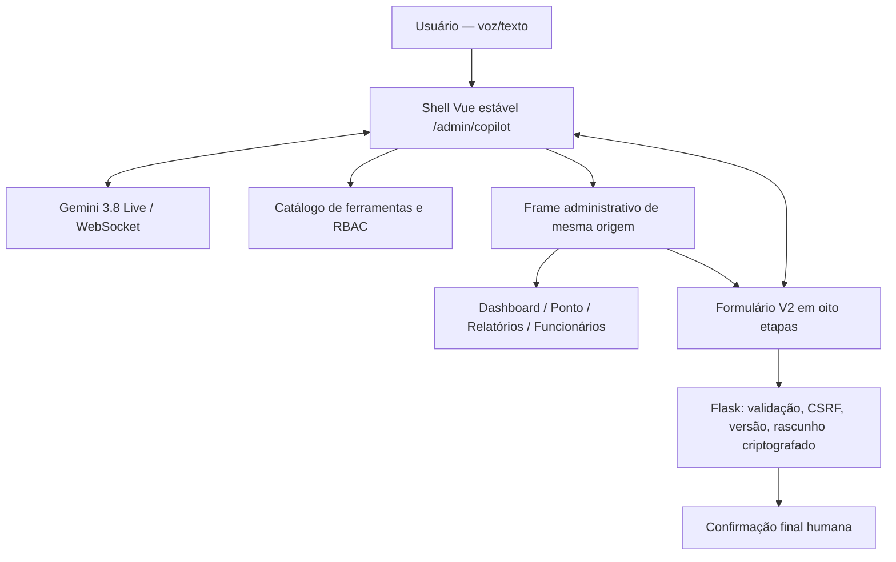

# ADR — Shell persistente Gemini Live da Potiguar

**Data:** 14/11/2026
**Classificação:** implementação em homologação isolada, não produção.
**Decisor técnico:** MESTRE, a pedido do responsável humano.
**Branch:** `feat/potiguar-conversational-controller-20261113`.
**Escopo:** corrigir queda da sessão Live durante navegação entre telas administrativas.

## Problema e objetivo

Antes, a ferramenta `navigate_potiguar` chamava `window.location.assign` na página superior. Isso descarregava o Vue, fechava o WebSocket, destruía o estado do microfone e interrompia o contexto da conversa. Ao abrir o cadastro V2, um segundo `OnboardingEmbed.vue` oferecia outra conexão Gemini independente.

**Objetivo:** manter uma única sessão Live e o mesmo microfone enquanto o usuário navega, executa ferramentas e preenche etapas autorizadas no mesmo shell, preservando o controle humano sobre cadastros, permissões, biometria e ponto.

## Decisão arquitetural

Adotar **shell persistente autenticado em `/admin/copilot` com área administrativa em iframe de mesma origem**, em vez de converter imediatamente todo o Flask/Jinja em SPA ou transferir o WebSocket para ServiceWorker/SharedWorker.

Justificativas:

- preserva rotas, templates, formulários, CSRF e RBAC existentes;
- desacopla o ciclo de vida da conexão Gemini Live do ciclo de vida da tela;
- mantém o DOM, áudio, configuração e histórico da sessão no Vue pai, sem recarregamento entre módulos;
- permite que links e redirects das telas Jinja naveguem **dentro** do frame;
- evita reescrever o cadastro V2 de oito etapas e reduz risco de regressão.

Trade-offs:

- navegador tem duas regiões de rolagem; a interface móvel usa dock de voz fixo;
- navegação só é persistente **dentro de `/admin/copilot`**; abrir outra aba do navegador, recarregar o shell ou sair do modo Copiloto inicia outro ciclo de vida;
- fluxos de câmera/autenticação exigem `Permissions-Policy` e enquadramento apropriados;
- ferramentas do modelo Extended ainda não estão habilitadas nesta implementação;
- uma queda real de rede encerra a sessão do provedor, embora o estado de tela e o histórico local permaneçam enquanto o shell estiver montado.

## Componentes e fronteiras

**Proprietário único de Live:** `frontend/copilot/src/App.vue` mantém `PotiguarLive`, status, microfone e chat, mesmo quando `iframe.app-frame` muda de documento.

**Roteamento:** `navigate_potiguar` resolve apenas destinos do `/admin/copilot/meta`, navega dentro do frame e devolve `navigated` somente depois que `onload` verifica o destino real, inclusive os redirects até `/admin/onboarding/<draft_uuid>`. Links no menu do shell usam `target="potiguar-application"` e comandos do modelo nunca aceitam URLs livres.

**Contexto:** `frontend/copilot/src/persistent-shell.js` valida rotas, redirects e `postMessage`. A URL do shell registra a tela ativa em `?view=...`, sem copiar valores de campos, e restaura a rota ao recarregar (mas não a sessão Live remota).

**Cadastro V2:** `static/admin-onboarding-v2.js` detecta o shell autorizado pelo caminho do pai. No shell, oculta o botão de segundo Copiloto, recebe `begin` e comandos do pai e envia `context`, `question`, `filled`, `review` e recibos ao pai. Na página isolada fora do shell, preserva o comportamento legado do `OnboardingEmbed.vue`.

**Ferramentas:** `PotiguarLive.connect(..., persistentShell:true)` registra navegação e ferramentas do cadastro na **mesma sessão** do Gemini 3.8 Live, com validação de `onboardingMode` na execução. Retorno de ferramenta aguarda resposta do controlador e do backend; valores pessoais já presentes no DOM não são transmitidos.

**Microfone e privacidade:** voz continua ativa ao navegar entre dashboard, relatórios e funcionários. Ao entrar no cadastro, o microfone é pausado preventivamente; campos protegidos bloqueiam microfone e texto do campo. A gravação definitiva de funcionário, ponto ou biometria não é delegada ao modelo.

## Endurecimento de segurança

- `app/observability.py`: somente GET 200 das telas em `SHELL_FRAME_ENDPOINTS` recebe `X-Frame-Options: SAMEORIGIN` e CSP `frame-ancestors 'self'`. Login, APIs JSON, operações POST, erros e a própria página do shell continuam com enquadramento negado.
- Shell: CSP `frame-src 'self'`, token efêmero no navegador, `Permissions-Policy: microphone=(self), camera=(self)`; o acesso à câmera nas telas legítimas continua dependendo da permissão do navegador.
- Mensagens: `event.origin`, `event.source` e `requestId` verificados; somente status, número de etapa e nome técnico de campo cruzam a fronteira de volta ao modelo.
- `app/admin/auth.py`: evita reescrever escopos idênticos em sessões Flask durante GETs concorrentes.
- `/admin/copilot/csrf-token`: token fresco, autenticado e `no-store`, obtido imediatamente antes do POST que solicita nova sessão Live.
- Estado de conexão marcado **apenas após `await ai.live.connect()`**; WebSocket aberto não é, isoladamente, comprovação de sessão pronta.
- Na perda de autenticação ou tentativa de carregar origem externa, o shell encerra a sessão Live por segurança.

## Evidências executadas

| Teste | Resultado |
| --- | --- |
| JS e regras de ferramentas, PII, roteamento, continuidade | 35/35 PASS |
| Flask backend, escopo e CSP | 21/21 PASS com teste de CSRF atualizado |
| Navegador Chrome móvel emulado: V2 legado | 19/19 PASS |
| Navegador Chrome móvel emulado: shell público + Gemini Live real | 12/12 PASS |
| WebSocket entre módulos | 1 aberto, 0 encerramentos na navegação |
| Microfone real do Chrome com dispositivo de teste | Ativo durante navegação, desligado sob comando sem fechar Live |
| Navegação via function calling real | `navigate_potiguar` conduziu à lista de funcionários |
| Gemini + controlador V2 + Flask real | `relation_type=CLT comum` aplicado e persistido no rascunho sintético |
| Novo funcionário criado sem humano | 0; nenhuma conclusão executada |
| JavaScript no teste público | 0 exceções |

Os resultados valem para Chrome headless com emulação 412×896 e dispositivo falso do navegador. **Não equivalem à certificação de microfone em um aparelho físico**.

## Publicação isolada e rollback

O ambiente público de teste existente usa a branch acima por bind mounts de arquivos Jinja/JS/CSS. Dois arquivos Python adicionais (`app/observability.py` e `app/admin/auth.py`) foram copiados somente para a camada de escrita do container de homologação isolada `potiguar-copilot-mobile-hml-20261113`; cópias do estado anterior foram guardadas na área local da homologação. Isso **não** constitui imagem de deploy reprodutível: antes de produção, gerar imagem versionada com SHA exato e pipeline de promoção/rollback.

A homologação anterior `potiguar-copilot-hml-20261111` e a produção não foram alteradas. O túnel público Cloudflare Quick Tunnel é temporário e depende de o computador anfitrião permanecer conectado.

## Critérios restantes antes de produção

1. Testar em smartphone físico (Android/iPhone): HTTPS, autorização do microfone, VAD, alternância de abas internas, bloqueio de tela, suspensão e reconexão.
2. Revisar LGPD e transferência/retensão de dados pessoais. O nome completo é PII, embora conste entre os campos atualmente sugeríveis.
3. Validar sessão expirada no meio de uma navegação e recuperação sem perda de rascunho.
4. Reproduzir implantação em imagem imutável com testes de segurança, auditoria, assinatura e gate humano de promoção.
5. Não confundir continuidade da sessão Live **entre telas do shell** com persistência após fechamento da aba, recarga ou perda da rede.
